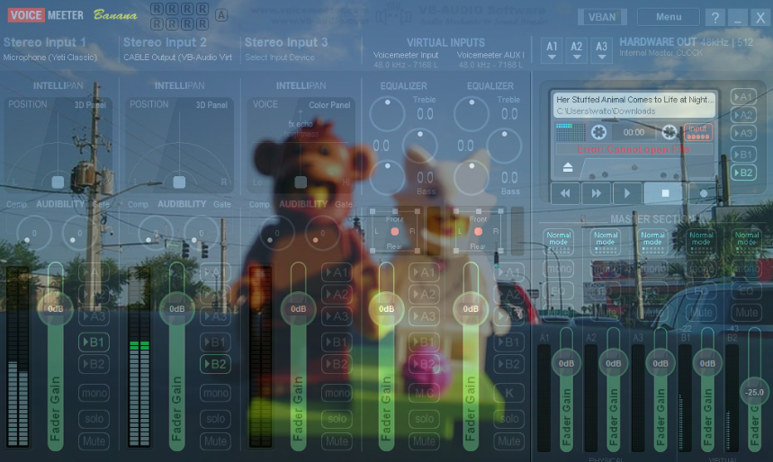

# Voicemeeter Background

*Illustration: simplified interface, not the real Voicemeeter window.*

Shows an image or a slideshow **on top of the Voicemeeter window** (Standard, Banana, Potato) and **follows it in real time**. Windows only. No VMChroma component, no injected DLL, no Voicemeeter file modified.

> Independent project, not affiliated with VB-Audio. "Voicemeeter" is a trademark of VB-Audio Software.

## How the tracking works

- Window position, size and resizing are tracked at roughly 60 frames per second.
- Window order: the image stays right above Voicemeeter. A window placed in front of Voicemeeter also covers the image.
- Voicemeeter minimized, hidden or on another virtual desktop: the image hides, then comes back as soon as it reappears.
- Voicemeeter set to "always on top": the image follows.
- 125% / 150% scaling or multiple monitors: coordinates are in physical pixels (DPI-aware).
- Voicemeeter restarted: the new window is found automatically.
- The overlay is click-through and never takes focus, so you keep using Voicemeeter normally.

## Important: limitation of this method

Windows does not let an external application insert an image *behind* another application's controls. The image is therefore **blended over** the whole client area and can overlap texts, buttons and meters. Keep the opacity between **10% and 25%** so everything stays readable.

## Features

- Single image or slideshow from a folder (alphabetical or random order).
- Opacity, darkening, blur, "fill" or "fit" framing.
- Cross-fade between slideshow images.
- Option to also cover the title bar.
- Start with Windows.
- Settings in `%LOCALAPPDATA%\VoicemeeterBackground\settings.json`, log in `overlay.log`.

## Run from source

1. Install Python 3 for Windows.
2. Run `run.bat`.
3. Pick an image or a folder, then click **Activer / actualiser le fond** (enable / refresh background).
4. Adjust the opacity (start at 10–25%).

The app must stay open (it can be minimized) as long as the background is in use.

## Build an EXE

Run `build.bat`: the executable is created in `dist\VoicemeeterBackground.exe`.

Note: unsigned PyInstaller executables are sometimes flagged by Windows SmartScreen or antivirus software (false positive). The code is open, and you can build the EXE yourself with `build.bat`.

## Privacy

No network access, no telemetry. Image paths and preferences stay on your PC.

## License

MIT see [LICENSE](LICENSE).
